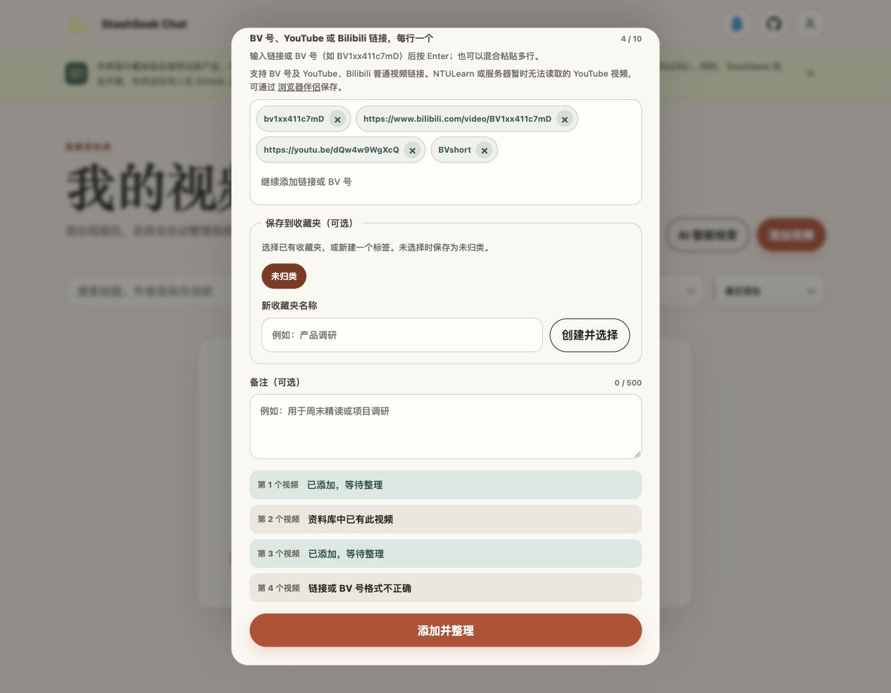
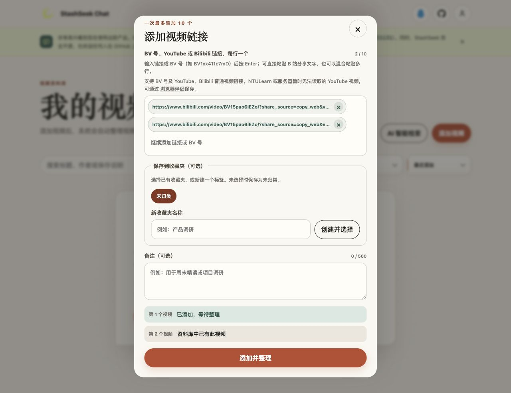

# BV Input Verification — 2026-10-15

## Result

Local implementation and independent review are complete, including the user
requested full-share-text extension. Add Videos accepts a standalone BV ID,
supported video URLs and copied Bilibili sharing text through the unchanged
`urls` request.
Only an exact 12-character ASCII BV input is expanded into a canonical Bilibili
HTTPS URL before the existing URL checks. Prefix case is normalized; suffix case
is preserved. Frontend extracts display entries through `parseVideoInput`; the server remains
the authority for URL admission and canonicalization.

The user approved the final scope with “好的” on 2026-10-15. Existing SSO, chat,
history and other uncommitted work has been retained. The seven original code/test/spec/doc
paths for this feature were clean before this task; two feature-local helper/test
files were added for share extraction; their baseline copies are in
`/private/tmp/stashseek-before-bv-input`. Commit approval is still pending. No
production deployment, real Bilibili fetch, durable save or queue publish occurred.

## Automated Verification

| Command / gate | Result |
| --- | --- |
| `NOTEBOOK_AGENT_ENV=development DATABASE_URL=sqlite:// .venv/bin/python -m pytest tests/test_bilibili_url.py tests/test_ingest_submission.py tests/test_web_api_library.py` | **200 passed**, independently re-run |
| Full frontend test suite | **227 passed** |
| `pnpm typecheck`, `pnpm lint`, `pnpm build`, `pnpm check:api` | Passed |
| Full backend suite using disabled external providers, fake API key and deliberately unavailable test DB | **1060 passed, 84 skipped, 2 failed** |
| `git diff --check` | Passed |

The two full-suite failures are the same unrelated, pre-existing date-sensitive
tests recorded before this task: `test_save_restore_early_return_is_committed_and_retry_queue_failure_is_retryable`
and `test_delete_restore_and_resave_converge_on_same_item` in
`tests/test_item_management_tools.py`. They use August deletion dates while
submission reads the actual date; on 2026-10-15 the 30-day retention guard returns
`purge_in_progress` instead of their expected `restored`. Neither that file nor
the retention implementation was modified. Integration skips require separate
runtime/database setup; there were 14 existing MSAL response-mode warnings.

Focused tests prove BV prefix/whitespace handling and suffix preservation;
malformed, prose, short-link and foreign-host rejection; local mixed-batch
preflight without fetches or subprocesses; both BV-first and URL-first input
reusing a single tenant-owned item/dispatch within a batch and on later requests,
with only one publisher call. Frontend tests prove unconfirmed bare-BV drafts and
mixed multiline rows reach the existing submission boundary without case changes.

## Browser Evidence

The actual Vite frontend was exercised in a separate in-app-browser tab on
`http://localhost:5174/library`, connected to a disposable API on port 8001. The
fixture called the real `prepare_submission` but used an in-memory result registry
instead of a database or queue. It did not contact Bilibili or YouTube.

Through the native Add Videos dialog, submit:

```text
bv1xx411c7mD
https://www.bilibili.com/video/BV1xx411c7mD
https://youtu.be/dQw4w9WgXcQ
BVshort
```

The page retained input order, showed the duplicate on row 2 and a format error on
row 4. The fixture's recorded preflight confirmed identical canonical references
for rows 1 and 2 and only two distinct valid references overall. Console errors:
none. This proves input and display behavior; its queued/duplicate results are
synthetic and do not demonstrate production ingestion.



The temporary test tab and ports 8001/5174 were closed. The original
`http://127.0.0.1:5173/login` page was retained. Its stopped original demo processes
were restarted on 8000/5173 with the original read-only behavior, without installing
a system service. Adding real videos still requires a configured writable backend
and queue. This local change has not been deployed to the online project.

## Review and Documentation

Independent Trellis check found no required fixes. The Bilibili connector code
itself remains URL-only; expansion lives at the shared submission boundary.
The implemented contract and user instructions are recorded in
`.trellis/spec/backend/bilibili-connector.md` and `docs/how-to/use-web-library.md`.


## Full Share-Text Extension — Final Evidence

The user supplied the complete copied title and Bilibili URL, then clarified
“上面的全部 包括文字” and “自动去除文字提取链接”. These explicit instructions
expanded the same in-progress task and superseded the original share-prose
exclusion. The updated implementation accepts that concrete behavior.

- The user's literal original text was verified through the actual local
  `normalize_item_reference`, including its tracking parameters, and returns
  `BV15pao6iEZo` / `https://www.bilibili.com/video/BV15pao6iEZo`. It also succeeds
  when the title and URL are on separate lines. The user's tracking hash is not
  copied into repository fixtures or screenshots.
- Through the real in-app-browser clipboard paste action, same-line and split-line
  shares each created exactly one URL tag, without a title-only row. Submitting
  both showed queued/duplicate outcomes in the isolated in-memory fixture and no
  format error. The fixture recorded two identical canonical references and one
  distinct video. No real video was fetched, saved or queued.
- Frontend paste, Enter and direct submit use the same helper, with selection-aware
  draft merging, existing-tag retention, independent invalid/BV rows retained,
  and the ten-entry limit checked after extraction. Complete URL candidates,
  including unsupported schemes/protocol-relative URIs, remain intact for server
  validation. Same-line ordinary sharing prose is removed as requested.
- Independent check found and corrected one missing frontend protocol-relative URI
  candidate. Root also reproduced URI-internal Chinese punctuation deleting later
  `p=2` / fragments; failing tests were added before the fix. The final lexer keeps
  the complete token and trims only terminal Chinese share punctuation. Ordinary
  nested tracking URL values retain prior Bilibili/YouTube behavior, while foreign
  outer URIs and a second URL joined after Chinese share punctuation are rejected.
- Final independent focused backend result: **200 passed**. Final full frontend:
  **227 passed**. TypeScript, lint, production build, generated API stale check,
  Python compilation, context validation and whitespace checks passed. The final
  full backend suite is **1060 passed, 84 skipped, 2 failed**; the two unrelated
  date/retention failures remain exactly as documented above.



The isolated test tab and ports 8001/5174 were closed. Existing user tabs and
original demo settings were preserved. No Git commit, push or deployment was
performed; `commit-plan.md` describes the final nine-file product scope and does
not reuse approval for the superseded seven-file proposal.
